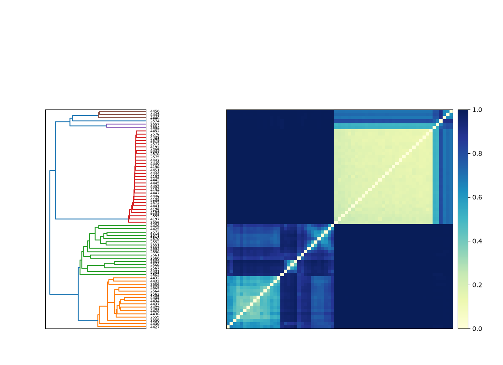
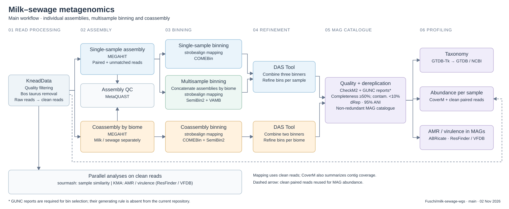

```{r, message=FALSE}
library(tidyverse)
library(ape)
library(ggtree)
library(ggtreeExtra)
library(ggnewscale)
metasample <- read_tsv("../data/samples.tsv", col_types = list(sample_id = col_factor()))
```

### kneaddata

Most milk samples have a high proportion of reads removed as *Bos taurus*. Samples 3574, 4448, 4449, and 4450 retain a relatively larger proportion of non-host reads. Sewage samples generally have a low proportion of host reads and retain substantially more reads for downstream microbial analysis.

```{r, message=FALSE}
kneaddata <- read_tsv("../data/kneaddata_read_counts.tsv",
                      col_types = list(Sample = col_factor())) %>%
  rename(sample_id = Sample) %>%
  left_join(metasample, by = "sample_id") %>%
  relocate(biome, .after = 1)
```

```{r}
knead_plot <- kneaddata %>%
  transmute(
    sample_id, biome,
    raw_reads = `raw pair1` + `raw pair2`,
    trimmed_reads = `trimmed pair1` + `trimmed pair2` + `trimmed orphan1` + `trimmed orphan2`,
    decontaminated_reads = `decontaminated bosTau9 pair1` + `decontaminated bosTau9 pair2` +
      `decontaminated bosTau9 orphan1` + `decontaminated bosTau9 orphan2`,
    saved_reads = `final pair1` + `final pair2` + `final orphan1` + `final orphan2`) %>%
  mutate(
    bos_taurus_reads = trimmed_reads - decontaminated_reads,
    other_removed_reads = raw_reads - bos_taurus_reads - saved_reads) %>%
  select(sample_id, biome, saved_reads, other_removed_reads, bos_taurus_reads) %>%
  pivot_longer(-c(sample_id, biome), names_to = "read_type", values_to = "reads") %>%
  mutate(
    read_type = factor(read_type, levels = c("saved_reads", "other_removed_reads", "bos_taurus_reads"),
                       labels = c("saved", "trimmed", "bos taurus")),
    biome = factor(biome, levels = c("milk", "sewage")),
    sample_id = fct_rev(factor(sample_id)))
```


```{r, fig.width=9, fig.height=5}
p_knead <- ggplot(knead_plot, aes(reads, sample_id, fill = read_type)) +
  geom_col(position = position_stack(reverse = TRUE)) +
  facet_wrap(~biome, nrow = 1, scales = "free_y") +
  scale_x_continuous(labels = scales::label_number(scale_cut = scales::cut_short_scale())) +
  scale_fill_manual(breaks = c("saved", "trimmed", "bos taurus"),
                    values = c("saved" = "#3b82a0", "trimmed" = "#bdbdbd", "bos taurus" = "#e69f00")) +
  labs(x = "total raw reads", y = "sample", fill = "read category",
       title = "raw reads by processing outcome") +
  theme_minimal() +
  theme(panel.grid.major.y = element_blank())
ggsave("../results/knead.png", p_knead, width = 9, height = 5, dpi = 300, bg = "white")
p_knead
```
### sourmash

The distance matrices show a clear separation between milk and sewage samples. For angular distance, the median distance is 0.184 among milk samples, 0.822 among sewage samples, and 0.9997 between biomes. This indicates greater similarity among milk samples and higher variability among sewage samples when k-mer abundance is considered.

Jaccard distances are high within both milk and sewage samples (median 0.929 and 0.933, respectively) and nearly maximal between biomes (median 1.000). Since Jaccard ignores abundance, this suggests limited shared k-mer content even among samples from the same biome. These distances summarize sequence similarity and do not directly identify species.

Samples 4448, 4449, and 4450 cluster together, while sample 3574 falls outside this group and appears on a separate branch of the dendrogram.

```{r}

```

### pipeline overview

Reads are quality-filtered and depleted of *Bos taurus* DNA using KneadData.
Genome reconstruction combines single-sample assemblies, multisample binning
of concatenated individual assemblies, and coassembly by biome.

Bins are refined with DAS Tool, screened for quality, and dereplicated with
dRep to obtain a non-redundant MAG catalogue.

```{r, echo=FALSE, out.width="100%", fig.align="center"}
#| label: fig-pipeline
#| fig-cap: "Workflow overview showing assembly and binning strategies, MAG catalogue construction, and downstream profiling."

```

### amr and virulence profiling

AMR genes and virulence factors were quantified using ResFinder and VFDB. FPKM values were recalculated using the number of fragments after trimming but before host DNA removal, to account for differences in host DNA content between samples.

```{r, message=FALSE}
read_counts <- kneaddata %>%
  transmute(sample_id = as.character(sample_id),
            pre_host = `trimmed pair1` + `trimmed orphan1` + `trimmed orphan2`)

read_profile <- function(database, category) {
  metadata <- read_tsv(paste0("../data/", database, "_metadata.tsv"), show_col_types = FALSE) %>%
    transmute(gene_id, category = .data[[category]]) %>% distinct()
  if (anyDuplicated(metadata$gene_id)) stop("Conflicting gene categories in metadata")

  read_tsv(paste0("../data/", database, "_reads_abundance.tsv"), show_col_types = FALSE) %>%
    mutate(sample_id = as.character(sample_id)) %>%
    filter(pass_filters == 1) %>%
    left_join(metadata, by = "gene_id") %>%
    left_join(read_counts, by = "sample_id") %>%
    mutate(category = replace_na(category, "unclassified"),
           fpkm = fpkm * total_fragments / pre_host) %>%
    group_by(sample_id, category) %>%
    summarise(fpkm = sum(fpkm), .groups = "drop")
}
```

```{r}
plot_profile <- function(data, title) {
  data <- data %>%
    complete(sample_id = as.character(metasample$sample_id), category, fill = list(fpkm = 0)) %>%
    left_join(metasample %>% mutate(sample_id = as.character(sample_id)), by = "sample_id")

  sample_order <- data %>% group_by(sample_id) %>%
    summarise(total = sum(fpkm), .groups = "drop") %>%
    arrange(total) %>% pull(sample_id)

  ggplot(data, aes(fpkm, factor(sample_id, levels = sample_order), fill = category)) +
    geom_col() +
    facet_wrap(~biome, nrow = 1, scales = "free_y") +
    scale_x_continuous(labels = scales::label_number(scale_cut = scales::cut_short_scale())) +
    labs(x = "FPKM (pre-host normalization)", y = "sample", fill = "category", title = title) +
    ggqualpal::scale_fill_qualpal() +
    theme_bw() +
    theme(panel.grid.major.y = element_blank())
}
```

#### antimicrobial resistance

```{r, fig.width=11, fig.height=6, warning=FALSE}
#| label: fig-amr-profile
#| fig-cap: "AMR gene abundance by antibiotic class, normalized to pre-host-depletion fragments."

amr <- read_profile("resfinder", "antibiotic_class")
p_amr <- plot_profile(amr, "antimicrobial resistance")
p_amr
```

#### virulence factors

```{r, fig.width=11, fig.height=6, warning=FALSE}
#| label: fig-virulence-profile
#| fig-cap: "Virulence factor abundance by functional category, normalized to pre-host-depletion fragments."

vfdb <- read_profile("vfdb", "vf_category")
p_vfdb <- plot_profile(vfdb, "virulence factors")
p_vfdb
```

```{r}
bind_rows(amr %>% mutate(database = "ResFinder"),
          vfdb %>% mutate(database = "VFDB")) %>%
  group_by(database, sample_id) %>%
  summarise(total_fpkm = sum(fpkm), .groups = "drop") %>%
  complete(database, sample_id = as.character(metasample$sample_id), fill = list(total_fpkm = 0)) %>%
  left_join(metasample %>% mutate(sample_id = as.character(sample_id)), by = "sample_id") %>%
  mutate(status = if_else(total_fpkm > 0, ">0", "=0")) %>%
  count(database, biome, status) %>%
  pivot_wider(names_from = status, values_from = n, values_fill = 0)
```


### gtdb-tk taxonomy

GTDB-Tk phylogenetic trees were used to visualize bacterial and archaeal MAGs. MAGs classified through ANI screening are represented by their closest reference genomes rather than direct phylogenetic placements. Circular annotations indicate taxonomic order, species-level assignment, and placement method.

```{r, message=FALSE}
gtdb <- read_tsv("../data/gtdbtk_summary.tsv", show_col_types = FALSE)
```

```{r}
plot_gtdb_tree <- function(tree_type = "bac120", rank = "order", n_taxa = 15) {
  tree <- ape::read.tree(paste0("../data/gtdbtk.", tree_type, ".classify.tree"))
  domain_name <- c(bac120 = "Bacteria", ar53 = "Archaea")[[tree_type]]

  taxonomy <- gtdb %>%
    filter(domain == domain_name) %>%
    mutate(
      tree_tip = case_when(
        mag_id %in% tree$tip.label ~ mag_id,
        paste0("GB_", closest_genome_reference) %in% tree$tip.label ~ paste0("GB_", closest_genome_reference),
        paste0("RS_", closest_genome_reference) %in% tree$tip.label ~ paste0("RS_", closest_genome_reference),
        TRUE ~ NA_character_
      ),
      placement = if_else(tree_tip == mag_id, "phylogenetic", "ANI reference"),
      species_status = if_else(!is.na(species) & species != "", "classified", "unclassified"),
      taxon = replace_na(.data[[rank]], "unclassified"),
      taxon = forcats::fct_lump_n(factor(taxon), n = n_taxa, other_level = "Other")
    ) %>%
    filter(!is.na(tree_tip))

  if (anyDuplicated(taxonomy$tree_tip)) stop("Multiple MAGs mapped to the same tree tip")
  if (nrow(taxonomy) < 2) stop("Fewer than two MAGs matched the tree")

  tree <- ape::keep.tip(tree, taxonomy$tree_tip)

  ggtree(tree, layout = "circular", linewidth = 0.15) +
    geom_fruit(data = taxonomy, geom = geom_tile, mapping = aes(y = tree_tip, x = 1, fill = taxon),
               offset = 0.02, pwidth = 0.05, width = 0.05) +
    ggqualpal::scale_fill_qualpal(name = rank,
                                  list(h = c(0, 360), s = c(0.7, 1), l = c(0.35, 0.65))) +
    new_scale_fill() +
    geom_fruit(data = taxonomy, geom = geom_tile, mapping = aes(y = tree_tip, x = 1, fill = species_status),
               offset = 0.02, pwidth = 0.05, width = 0.05) +
    scale_fill_manual(name = "species assignment", values = c(classified = "#2166ac", unclassified = "#d9d9d9")) +
    theme(legend.position = "right", legend.key.size = grid::unit(0.35, "cm"))
}
```

#### bacteria

```{r, fig.width=12, fig.height=8, message=FALSE, warning=FALSE}
#| label: fig-gtdb-bacteria
#| fig-cap: "Bacterial MAGs represented in the GTDB-Tk tree. ANI-classified MAGs are shown through their closest reference genomes; rings indicate taxonomic order, species assignment, and placement method."

p_bac <- plot_gtdb_tree("bac120")
ggsave("../results/gtdb_bacteria.png", p_bac, width = 12, height = 9, dpi = 300, bg = "white")
p_bac
```

### mags quality

MAG quality was assessed based on genome completeness and contamination. Retained MAGs were classified as high quality (≥90% completeness, ≤5% contamination) or medium quality (≥50% completeness, ≤10% contamination). These categories do not include the additional MIMAG quality criteria.

```{r, message=FALSE}
mags_info <- gtdb %>%
  left_join(read_tsv("../data/bin_quality_summary.tsv", show_col_types = FALSE) %>%
              select(bin_id:selected_for_drep), by = join_by(mag_id == bin_id)) %>%
  mutate(quality = case_when(
    completeness >= 90 & contamination <= 5 ~ "high",
    completeness >= 50 & contamination <= 10 ~ "medium",
    TRUE ~ NA_character_
  ), quality = factor(quality, levels = c("high", "medium")))
```

```{r}
mags_info %>%
  group_by(domain, quality) %>%
  summarise(n = n(), median_completeness = median(completeness, na.rm = TRUE),
            median_contamination = median(contamination, na.rm = TRUE), .groups = "drop")
```

```{r, fig.width=8, fig.height=4.5}
#| label: fig-mags-quality
#| fig-cap: "Genome completeness and contamination of reconstructed MAGs."

p_quality <- ggplot(mags_info, aes(completeness, contamination, color = quality)) +
  geom_point(alpha = 0.6, size = 1.5) +
  geom_vline(xintercept = c(50, 90), linetype = "dashed", color = "grey60") +
  geom_hline(yintercept = c(5, 10), linetype = "dashed", color = "grey60") +
  facet_wrap(~domain) +
  scale_color_manual(values = c(high = "#1b9e77", medium = "#e6ab02")) +
  labs(x = "completeness (%)", y = "contamination (%)", color = "MAG quality") +
  theme_bw()

ggsave("../results/mags_quality.png", p_quality, width = 8, height = 4.5, dpi = 300, bg = "white")
p_quality
```


### mags taxonomic composition

MAG abundances were estimated from CoverM read counts and GTDB-Tk classifications. RPKM values were normalized by genome length and the number of reads before *Bos taurus* removal. Relative abundances were calculated as the fraction of pre-host-depletion reads assigned to each MAG, without rescaling the profiles to 100%.

The 17 most abundant orders across all samples and the two most abundant orders in milk were retained, with remaining orders grouped as Other.

```{r}
mags_abundance <- read_tsv("../data/mags_abundance.tsv", show_col_types = FALSE) %>%
  mutate(sample = as.character(sample)) %>%
  filter(mag_id != "unmapped") %>%
  left_join(mags_info %>% select(mag_id, order), by = "mag_id") %>%
  left_join(kneaddata %>% transmute(sample = as.character(sample_id),
            pre_host = `trimmed pair1` + `trimmed pair2` + `trimmed orphan1` + `trimmed orphan2`), by = "sample") %>%
  left_join(metasample %>% transmute(sample = as.character(sample_id), biome), by = "sample") %>%
  mutate(order = replace_na(order, "unclassified"),
         rpkm_host = read_count * 1e9 / (length * pre_host),
         relative_host = 100 * read_count / pre_host)
```

```{r}
top_orders <- mags_abundance %>%
  group_by(order) %>%
  summarise(abundance = sum(rpkm_host, na.rm = TRUE), .groups = "drop") %>%
  slice_max(abundance, n = 17, with_ties = FALSE) %>% pull(order)

top_milk <- mags_abundance %>%
  filter(biome == "milk") %>%
  group_by(order) %>%
  summarise(abundance = sum(rpkm_host, na.rm = TRUE), .groups = "drop") %>%
  slice_max(abundance, n = 2, with_ties = FALSE) %>% pull(order)

top_orders <- union(top_orders, top_milk)

mags_plot <- mags_abundance %>%
  mutate(order = if_else(order %in% top_orders, order, "Other")) %>%
  group_by(sample, biome, order) %>%
  summarise(across(c(rpkm_host, relative_host), ~sum(.x, na.rm = TRUE)), .groups = "drop")
```

```{r, fig.width=12, fig.height=6}
p_mags_rpkm <- ggplot(mags_plot, aes(rpkm_host, sample, fill = order)) +
  geom_col() +
  facet_wrap(~biome, nrow = 1, scales = "free_y") +
  scale_x_continuous(labels = scales::label_number(scale_cut = scales::cut_short_scale())) +
  labs(x = "RPKM (pre-host normalization)", y = "sample", fill = "order",
       title = "MAG taxonomic abundance") +
  theme_bw() +
  theme(panel.grid.major.y = element_blank()) +
  ggqualpal::scale_fill_qualpal()

ggsave("../results/mags_rpkm_profile.png", p_mags_rpkm, width = 12, height = 6, dpi = 300)
p_mags_rpkm
```


```{r, fig.width=12, fig.height=6}
#| label: fig-mags-composition
#| fig-cap: "Taxonomic composition of reconstructed MAGs by sample, grouped by GTDB-Tk order."

p_mags_relative <- ggplot(mags_plot, aes(relative_host, sample, fill = order)) +
  geom_col() +
  facet_wrap(~biome, nrow = 1, scales = "free") +
  scale_x_continuous(labels = scales::label_number(suffix = "%")) +
  labs(x = "relative abundance (pre-host, %)", y = "sample", fill = "order",
       title = "MAG relative abundance") +
  theme_bw() +
  theme(panel.grid.major.y = element_blank()) +
  ggqualpal::scale_fill_qualpal()

ggsave("../results/mags_relative_profile.png", p_mags_relative, width = 12, height = 6, dpi = 300)
p_mags_relative
```

### mags functional profiling

AMR and virulence-associated genes were screened in reconstructed MAGs using ABRicate with ResFinder and VFDB. Detected genes were linked to GTDB-Tk and NCBI classifications and genome quality estimates. Gene detection does not necessarily indicate pathogenicity.

```{r, message=FALSE}
ncbi <- read_tsv("../data/ncbi_taxonomy.tsv", show_col_types = FALSE)
amr_meta <- read_tsv("../data/resfinder_metadata.tsv", show_col_types = FALSE) %>%
  select(gene_id, category = antibiotic_class) %>% distinct()
vfdb_meta <- read_tsv("../data/vfdb_metadata.tsv", show_col_types = FALSE) %>%
  select(gene_id, category = vf_category) %>% distinct()

mag_genes <- bind_rows(
  read_tsv("../data/abricate_resfinder_2.6.0.tsv", show_col_types = FALSE) %>%
    mutate(database = "AMR") %>% left_join(amr_meta, by = c("GENE" = "gene_id")),
  read_tsv("../data/abricate_vfdb_2026-10-26.tsv", show_col_types = FALSE) %>%
    mutate(database = "VFDB") %>% left_join(vfdb_meta, by = c("GENE" = "gene_id"))
) %>%
  transmute(mag_id = str_remove(basename(`#FILE`), "\\.(fa|fna|fasta)(\\.gz)?$"),
            database, gene = GENE, category = replace_na(category, "unclassified"),
            identity = `%IDENTITY`, coverage = `%COVERAGE`) %>%
  distinct()
```

#### MAGs with detected genes

```{r}
mag_summary <- mag_genes %>%
  group_by(mag_id, database) %>%
  summarise(n_genes = n_distinct(gene), genes = paste(sort(unique(gene)), collapse = ", "), .groups = "drop") %>%
  pivot_wider(names_from = database, values_from = c(n_genes, genes), values_fill = list(n_genes = 0, genes = "")) %>%
  left_join(mags_info %>% select(mag_id, species, quality, completeness, contamination), by = "mag_id") %>%
  left_join(ncbi %>% select(mag_id, ncbi_most_specific), by = "mag_id")

mag_summary %>%
  select(mag_id, species, ncbi_most_specific, quality, completeness, contamination,
         n_genes_AMR, genes_AMR, n_genes_VFDB, genes_VFDB) %>%
  arrange(desc(n_genes_VFDB), desc(n_genes_AMR))
```

#### AMR and virulence gene distribution

```{r}
plot_genes <- mag_genes %>%
  left_join(mags_info %>% select(mag_id, species, genus), by = "mag_id") %>%
  left_join(ncbi %>% select(mag_id, ncbi_most_specific), by = "mag_id") %>%
  mutate(classification = coalesce(ncbi_most_specific, species, genus, "unclassified"),
         mag_label = paste0(mag_id, " | ", classification),
         gene_label = paste(database, gene, sep = ": ")) %>%
  distinct(mag_id, mag_label, database, gene_label, category)

amr_matrix <- plot_genes %>%
  filter(database == "AMR") %>%
  mutate(present = 1L) %>%
  select(mag_id, gene_label, present) %>%
  pivot_wider(names_from = gene_label, values_from = present, values_fill = 0) %>%
  column_to_rownames("mag_id") %>% as.matrix()

mag_order <- rownames(amr_matrix)[hclust(dist(amr_matrix, method = "binary"), method = "average")$order]
mag_order <- c(mag_order, setdiff(unique(plot_genes$mag_id), mag_order))

mag_labels <- plot_genes %>% distinct(mag_id, mag_label) %>%
  slice(match(mag_order, mag_id)) %>% pull(mag_label)

gene_order <- plot_genes %>% count(database, category, gene_label, sort = TRUE) %>%
  arrange(database, category, desc(n)) %>% pull(gene_label)

plot_genes <- plot_genes %>%
  mutate(mag_label = factor(mag_label, levels = rev(mag_labels)),
         gene_label = factor(gene_label, levels = gene_order))
```

```{r, fig.width=11, fig.height=8}
#| label: fig-mag-genes
#| fig-cap: "Distribution of AMR and virulence-associated genes across reconstructed MAGs. Colors indicate functional categories; MAG labels include the most specific available taxonomic classification."

p_mag_genes <- ggplot(plot_genes, aes(gene_label, mag_label)) +
  geom_tile(aes(fill = category), color = "white", linewidth = 0.3) +
  facet_grid(~database, scales = "free_x", space = "free_x") +
  ggqualpal::scale_fill_qualpal() +
  labs(x = "gene", y = "MAG | taxonomic classification", fill = "category") +
  theme_bw() +
  theme(panel.grid.major = element_line(color = "grey85", linewidth = 0.3),
        panel.grid.minor = element_blank(),
        axis.text.x = element_text(angle = 45, hjust = 1, vjust = 1, size = 7),
        axis.text.y = element_text(size = 7)) +
  theme(legend.position = "bottom")

ggsave("../results/mag_genes.png", p_mag_genes, width = 14, height = 6, dpi = 300)
p_mag_genes
```


